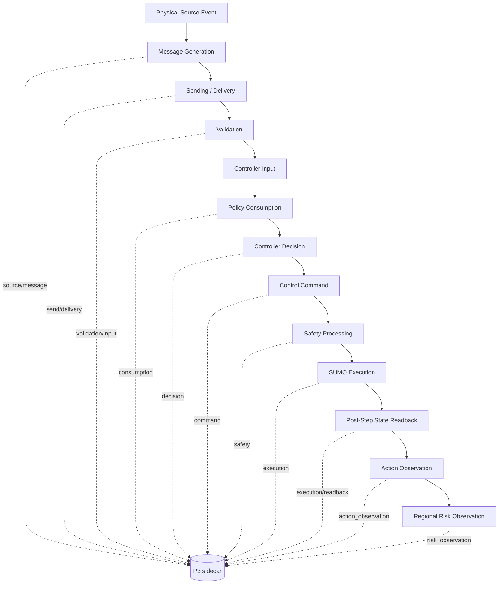

# P7 Task1 — 端到端集成实施方案

**用途:** 为 P7 Task2 提供一次性整体接线方案。
**当前状态:** `BLUEPRINT_READY_BLOCKED_ON_REAL_POLICY`。
**约束:** 仅规划；不修改生产控制代码、不启动 SUMO/TraCI、不升级 Adoption/Safety/P4 科研定义。

## 1. 目标架构

P7 Task2 应在真实目标车辆策略已经由研究者指定后，在生产者边界增加薄的 Evidence Adapter。Adapter 只记录事实和引用，不改变控制器动作、不重算风险、不替换既有 SUMO engine。



当前真实代码中只有部分边已存在：Stage 0.1 有工程 source/time condition、TraCI setter、post-step readback 和旧 protocol/action/risk 表；Stage 0.5 有执行管理、环境供给、Observer 和测量输出；P3 sidecar 已有结构验证但没有真实 producer 调用。

## 2. 数据流边界和证据等级

| 边 | 当前实现 | 当前产生模块 | ID/时间 | Task2 新接口 | 当前证据等级 |
|---|---|---|---|---|---|
| Physical Source Event → Message Generation | Stage 0.1 的 `source_present`/工程 `generated_time`；Stage 0.5 无消息 | `stage_0_1_sumo._run_cell()`；未来 source observer | `run_id/source_event_id`；simulation time | P3 `source` + `message` | 工程字段；非真实 source qualification |
| Message Generation → Sending | Stage 0.1 `sent_time=generated_time` 是兼容字段；无 transport attempt | Stage 0.1 protocol row | `message_id`；计划时间 | P3 `send` | 未观察/未实现 |
| Sending → Delivery | 未发现接收端回执 | 无 | `attempt_id/delivery_id`；receiver native clock | P3 `delivery` | Unknown |
| Delivery → Validation | Stage 0.1 有 `target_valid/freshness_valid` 字段；无 validator producer | 无真实 receiver validator | `delivery_id/validation_id` | P3 `validation` | Schema/fixture only |
| Validation → Controller Input | 无真实策略输入函数 | 未识别 | `validation_id/receipt_id`；available interval | P3 `input` | Missing |
| Controller Input → Policy Consumption | 无真实消费边界；P3 Proposed 状态可表达 | 未识别 | `receipt_id/consumption_receipt_id` | P3 `consumption` | Missing |
| Policy Consumption → Controller Decision | 无真实 decision | 未识别 | `decision_id`；strategy call order | P3 `decision` | Missing |
| Controller Decision → Control Command | Stage 0.1 setter 由时间分支触发；无 decision/command ID | `_run_cell()`；replay adapters | `decision_id/command_id`；Before Step | P3 `command` | Isolated engineering setter |
| Control Command → Safety Processing | 独立安全层未识别；SUMO native constraints 不能代替 | 无独立模块 | `command_id/intervention_id` | P3 `safety` | Not observed |
| Safety Processing → SUMO Execution | Stage 0.1 setter 和 replay setter存在；无调用回执 | TraCI call sites | `command_id/execution_id` | P3 `execution` | Partial |
| SUMO Execution → Post-Step Readback | 已实现 `simulationStep()` 后 getters/Observer | Stage 0.1、Stage 0.5、replay | `vehicle_incarnation_id/simulation_step` | P3 `execution` | Native readback exists; linkage missing |
| Post-Step Readback → Action Observation | Stage 0.1 action table、replay trace、Stage 0.5 state | P4/既有 artifact | `execution_refs/observation_ref` | P3 `action_observation` | Existing outputs; no P3 link |
| Action Observation → Regional Risk Observation | Stage 0.1 risk validation；Stage 0.5 measurement outputs | `formal_artifacts.py`、`formal_risk_measurement.py`、`stage_0_5_sumo.py` | `action_observation_refs/measurement_version` | P3 `risk_observation` | Existing measurement interfaces; attachment missing |

`producer_role`、`fixture_only` 和 producer 自报 hash 不是真实性认证。P7 manifest 必须把实际文件字节、源码版本和 sidecar 绑定起来。

## 3. P3 记录映射

P3 schema 的机器定义在 `code/src/riskprop/controller_evidence.py` L87–L119；完整关联验证在 L302–L629。P7 Task2 不应复制这些结构。

| P3 记录 | 真实接入位置 | 必需内容 | 当前状态 |
|---|---|---|---|
| `source` | source observer / qualification boundary | source type、qualification status、confirmation ref | 需真实 producer |
| `message` | message generator | sender、payload SHA256、payload ref/type、validity interval | Stage 0.1 只有旧 protocol 字段 |
| `send` | sender/transport call | attempt、transport ref、sent/failed/queued | 缺失 |
| `delivery` | receiver callback/read | attempt、delivery status、receiver native timestamp | 缺失；不能由 sender 写 |
| `validation` | receiver validator | validator id/version、status、reason | 缺失 |
| `controller` | controller instance initialization | controller/policy/code/config hash、controlled vehicle | 缺失 |
| `input` | policy input availability boundary | validation link、snapshot ref/hash、available time | 缺失 |
| `consumption` | policy input actually included/considered/rejected | input receipt、decision id、snapshot hash、Proposed boundary metadata | 缺失；边界未批准 |
| `decision` | strategy output boundary | decision id、status、consumed refs、control intent、no-change/command disposition | 缺失 |
| `command` | real TraCI wrapper | API and args, value/unit, validity, ack/status/failure | 需要包住现有 setter |
| `safety` | independent safety function, if any | original/modified command、layer/version、reason | 未识别；无机制则 Unknown |
| `execution` | post-step readback/command executor | execution status、actual v/a/x、readback ref、vehicle incarnation | readback partial, linkage missing |
| `action_observation` | P4 action adapter | execution refs、comparison ref、action status、raw observation hash | P4 output available, link missing |
| `risk_observation` | P4 risk adapter | action refs、measurement version、risk status、observation ref | existing measurements, link missing |

## 4. 六个接入点的实施顺序

### 4.1 Receiver / validation / input

在真实 receiver 中按实际调用顺序写 `delivery`，验证完成后写 `validation`，进入控制器缓存/输入队列时写 `input`。`input_status=AVAILABLE` 只能在验证状态为 `VALID` 且有可用时间/快照引用时使用；缓存、拒绝和未观测分别保留。

消息、尝试、送达和验证分别使用 `message_id`、`attempt_id`、`delivery_id`、`validation_id`。一条消息多次发送、多接收者和重发不能覆盖旧记录。

### 4.2 Policy consumption / decision

在实际策略输入组装函数处计算并保存 `input_snapshot_hash`，在策略真正纳入决策时写 `consumption`。`CONSIDERED`、`REJECTED`、`UNKNOWN` 与 `POLICY_INPUT_INCLUDED` 不得合并。随后在同一 controller instance 的策略输出点写 `decision`：

- `DECIDED` 可产生一个或多个 command；
- `UNCHANGED` 可以消费消息但 `command_disposition=NONE`；
- `FAILED` 不得产生 command；
- `UNKNOWN` 保留缺失原因。

当前 adoption boundary 仍是 `aad.p3.policy-input-adoption.proposed.v0.1 / PROPOSED`。Task2 可以记录事件，但不把它升级为正式科研定义。

### 4.3 Command / safety / execution

Command adapter 包住真正的 TraCI call。调用前写 `CREATED` 或 `ISSUED`，返回后写 `ACKNOWLEDGED`，异常写 `REJECTED/UNKNOWN`，被替代时用 `superseded_by` 链。命令参数原样保存，单位明确；`setAcceleration` 输入不是实际加速度。

若控制器中存在独立 safety filter，先写 original command，再写 modified/rejected command 和原因；若不存在，不能把 SUMO Krauss、安全速度模式或 collision getter称为独立安全层。Execution 记录在 post-step readback 中绑定 command，保存 `actual_acceleration`、`actual_speed`、`actual_position`、execution status、state readback ref 和车辆 incarnation。

### 4.4 P4 action/risk attachment

P7 不重写 P4 的动作比较或风险算法。Adapter 只把已有 action/risk output 的路径、SHA256、measurement version、固定 region/cohort/window 标识引用到 P3 `action_observation` / `risk_observation`。缺少 P4 质量或观测时，写 `UNKNOWN`/`RIGHT_CENSORED`，不填零、不从缺失推 no-change。

## 5. SUMO 同一步时序

建议真实控制路径采用以下时序：

```text
Before Step (phase=before_step)
  1. 读取当前 native simulation clock / simulation_step
  2. 读取并验证待处理消息和策略输入
  3. 写 decision/command/safety（若存在）
  4. 调用 TraCI command API，记录调用参数和返回/异常

simulationStep (phase=simulation_step)
  5. 调用 traci.simulationStep()

After Step (phase=after_step)
  6. 读取车辆存在性、incarnation、v/a/x、lane/edge、碰撞/teleport
  7. 写 execution
  8. 写 action/risk observation 引用
```

这只是调用顺序，不是严格物理时间证明。每条记录保存：

- `native_timestamp`、`time_unit`、`clock_id`；
- `simulation_step`、`phase`、`sequence`；
- `time_lower/time_upper`、`reference_clock_id`、`clock_mapping_version`；
- `observed_at`、`available_at`、Unknown/右删失 reason。

P3 `compare_times()` 只在同参考时钟的严格区间分离时给出 `BEFORE/AFTER`；同 step 的 sequence 只能给 `CALL_ORDER`。不要增加 epsilon。

## 6. 跨模块 ID 设计

建议所有 P7 sidecar record 共享以下上下文：

```text
run_id
pair_id
cell_id
block_id / assignment_id (可空但显式)
vehicle_id
vehicle_incarnation_id
source_event_id (可空)
message_id (接收链之后显式)
controller_instance_id
```

独立 natural IDs 必须分开：`source_event_id`、`message_id`、`attempt_id`、`delivery_id`、`validation_id`、`controller_instance_id`、`receipt_id`、`consumption_receipt_id`、`decision_id`、`command_id`、`intervention_id`、`execution_id`、`action_observation_id`、`risk_observation_id`。同一消息可进入多个决策；一个决策可零/多 command；一个 command 可有多次 safety/execution。

车辆 ID 不足以证明生命周期；必须使用 `vehicle_incarnation_id` 并关联 enter/active/exit/Unknown。车辆退出后无法读回应是 `VEHICLE_EXITED`、`RIGHT_CENSORED` 或 `UNKNOWN`，不能改写成未执行。

## 7. 证据真实性和最终 manifest

P7 Task2 应生成独立 sidecar 及最终 manifest。以下项目必须分开绑定：

| 证据对象 | 当前能力 | Task2 需增加 |
|---|---|---|
| 控制器源代码 SHA256 | Stage 0.5/既有 provenance 有部分代码 hash；Stage 0.1 有 implementation hashes | 真实 controller/policy source closure 的完整清单 |
| controller/policy version | P3 字段可表达，真实实例未登记 | controller registry、policy version 和 config hash |
| 策略配置 hash | P3 schema 可校验格式 | 原始 config 文件字节和 manifest 绑定 |
| SUMO executable version/hash | Stage 0.1/Stage 0.5 provenance 能记录 | 与真实 run 的 binary、`--version` 输出和 hash 一起封存 |
| TraCI binding version/hash | Stage 0.5 receipt 有 `traci_source_sha256` | 真实 run 的 import path/version/hash |
| 仿真输入文件 | 既有 manifest/provenance 分散存在 | network/route/config/demand 的文件 hash |
| payload 原始字节 | P3 只验 payload_hash 格式/一致性 | 原始 payload 文件/日志 byte hash + message ref |
| policy input snapshot | P3 只要求 ref/hash | snapshot 原始文件、生成时刻、schema 和 hash |
| 原始控制日志 | 现有 controller receipt/工程日志有限 | sender/receiver/policy/TraCI raw append-only logs |
| post-step readback | 多路径已读回 | execution state file/hash、车辆 incarnation 和 step |
| P3 sidecar | `EvidenceJournal.write()` 可独占创建 | sidecar hash、validation output、manifest entry |
| final manifest | 各阶段已有不同 manifest | 一份 P7 manifest 绑定上述全部对象及 Git SHA/dirty 状态 |

生产者自报的 hash 只算声明；manifest verifier 必须在本地读取同一文件并复算 SHA256。没有原始字节时只能写 Unknown。

## 8. P7 Task2 修改文件清单（计划）

以下是下一项任务的最小整体范围；本 Task1 不修改这些文件。

### 必须新增/修改

1. `code/src/riskprop/p7_controller_evidence_adapter.py`（建议新增）：包装 `EvidenceJournal`，统一 `EventContext`、`TimeEvidence`、ID、hash 和 append-only sidecar。
2. 真实 controller 所在模块（待研究者指定）：在 receiver/validator、policy input、decision 和 command call boundary 调用 adapter；若没有真实策略，先只提供明确的 protocol interface，不把 Stage 0.1 时程逻辑伪装成策略。
3. `code/src/riskprop/stage_0_1_sumo.py` 或研究者指定的真实 SUMO runner：在实际 command API 和 post-step readback 接入 adapter；保留旧 `protocol/action/risk` 表，不改其历史语义。
4. `code/src/riskprop/stage_0_5_sumo.py`（仅当 P7 选择 Stage 0.5 baseline 作为 P4 readback）：增加引用 adapter，不改 `compute_sumo_measurements()` 或 Formal P2。
5. `code/scripts/finalize_p7_controller_evidence.py`（建议新增）：绑定源码、config、SUMO/TraCI、输入、payload、snapshot、raw log、readback、sidecar，生成 manifest/SHA256SUMS。
6. `code/tests/test_p7_controller_evidence_adapter.py`（建议新增）：正常链、验证拒绝、消费无命令、安全修改、重复/过期、Unknown/右删失、跨 run/vehicle 外键、post-step readback。

### 不应修改

- `code/src/riskprop/formal_design.py` 的旧生命周期布尔契约；
- `code/src/riskprop/formal_artifacts.py` 的 Formal Parquet schema；
- `code/src/riskprop/formal_risk_measurement.py` 的 Formal P2/rho；
- `code/src/riskprop/stage_i_mechanism.py` 的 Task20 fixture 语义；
- P4 正式风险算法、阈值、区域/cohort/window 定义；
- Gate、Protocol Lock、Stage1.1 守卫。

## 9. 错误、缺失和 Unknown 规则

- 结构性错误：孤儿外键、跨 run/cell/pair、跨车辆 incarnation、重复 ID、冲突 payload hash、倒序有效期，立即由 `EvidenceError` 拒绝。
- 事实缺失：无时钟映射、未观测送达、未观察消费、未观察 safety、缺执行读回、车辆退出，保留相应 Unknown/Right-censored 状态和 reason。
- 不可确认不补零；未写 consumption 不推出“永远未采用”；没有 safety record 不写 `CONFIRMED_NONE`；命令存在但无 execution 不写 `NOT_EXECUTED`。
- 记录顺序通过 sequence/phase 保存；不得通过近邻时间戳自动拼接边，不得用全表最早事件拼出一条链。

## 10. 验收方案

P7 Task2 完成后至少需要：

1. 定向 adapter 测试通过，覆盖 14 类记录和六个核心接入点。
2. 只读复算 sidecar：schema、外键、时间、Unknown、manifest、源码/输入 hash 全部一致。
3. 至少一条真实 controller run 的 receiver→validation→input→consumption/decision→command→execution→post-step readback 记录；若真实策略仍不存在，验收必须停在明确的 `BLOCKED_NO_REAL_MESSAGE_DRIVEN_TARGET_POLICY`，不得用 fixture 替代。
4. 命令值与实际 v/a/x 分列保存，且能证明车辆 incarnation 和 simulation_step。
5. 有独立 safety layer 时能显示原始/修改后命令；没有时保留 `NOT_OBSERVED/UNKNOWN`。
6. P4 action/risk output 通过 observation ref、measurement version 和 hash 连接；不改变原有指标。
7. 运行后不改变 Formal A、Formal rho/P2、P4 标准、Gate、Protocol Lock 或科学结论状态。

当前验收前置条件尚未满足，因为真实 message-driven target policy 未被识别或指定。
